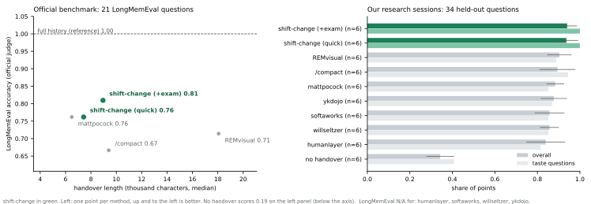

# shift-change

**Your next session should work like this one did.**

> **Status (2026-11-12): v0.1.**
> - **LongMemEval was re-measured with every run isolated from the operator's own setup.** On recalling facts, shift-change ties Claude Code's `/compact` (20/21 each); see below.
> - **The scripted-session table is still unverified.** It was measured in September 2026, before that isolation existed: the operator's `~/.claude/CLAUDE.md` reached every arm, including the no-handover baseline. It has not been re-run yet, and its raw fixtures stay out of this repo because they contain a non-English transcript.

Handovers for coding agents that carry the soul of the work (taste, rejected paths, what's still running, what's only assumed), and **prove it** by quizzing a fresh agent before you close the session.

<!-- demo: docs/assets/demo.gif -->

---

## The problem

You spend three hours with an agent. It learns that you want the conclusion first, that lowering the learning rate was already tried and failed, that "the clean set" means one specific file, that a sweep is running on the cluster. Then the context fills up, or you `/clear`, or you come back tomorrow.

The new session reads the summary and knows *what* was done. It does not know *how you want it done*. It proposes the rejected fix again. It writes you an essay. It resubmits the running job. It is like a colleague leaving and a stranger taking over their desk.

## The idea: borrow from hospitals

Hospitals hand patients between shifts dozens of times a day, and handoffs used to be a major source of errors. The **I-PASS** protocol fixed that with a structured handoff, and cut medical errors by 23% in a multi-site study (Starmer et al., *NEJM* 2014). Its last step is the one that matters: **the incoming person reads the handoff back**, so gaps are caught while the outgoing person is still there.

`shift-change` does both halves for coding agents:

1. **Write** an I-PASS handover: status, the picture and current hypotheses, next actions, no-go zones with reasons and reopen conditions, a table of your corrections turned into rules, and the evidence ledger (verified / assumed / unknown).
2. **Mine the raw transcript**, not just the agent's memory. Auto-compaction drops early turns, which is exactly where you corrected the agent most.
3. **Examine** a fresh subagent that sees only the handover: "The user asks X: do you do A or B?", "A labmate suggests lowering the lr; what do you say?". Every miss is fixed in the document, and the fresh agent is re-examined, until it passes.

You get a line like `Handover fidelity: 12/12 (after 1 patch round)` instead of hoping.

## What's inside

| Skill | When | What it does |
|---|---|---|
| `/shift-change` | end of a session | writes a named handover, runs the exam, proposes durable taste for `CLAUDE.md` |
| `/shift-start` | start of the next session | you confirm the session name; it checks the handover against the real world, reads back its plan and top uncertainties, **waits for your OK**, then deletes the handover |
| `/shift-recover` | after a session died without a handover | lists recent sessions so you confirm which one, mines its transcript, checks what actually finished (git, jobs, partial outputs), reads back a resume plan |
| `/shift-brief` | handing a task to a collaborator | traces every file the task needs, sanitizes secrets and paths, writes runnable acceptance criteria and a prompt for *their* agent, then has a fresh agent cold-start from the bundle before you send it |

## Benchmark

**Setup:**
- Two scripted research sessions, both replayed as real Claude Code sessions:
  - ML debugging, 1 compaction;
  - a paper revision, 3 compactions.
- 34 held-out questions, written before any runs.
- 10 handover methods, each run 3 times per session: 60 runs in total.

After each handover, a fresh agent that never saw the session answers the questions from the handover and the repo alone. A second benchmark runs the same comparison on **LongMemEval** (Wu et al., ICLR 2025) with its official questions, answers and judge prompts, so the evidence does not rest on sessions we wrote ourselves.



| Method | Overall (mean ± SD) | Taste | Facts from before compaction | Rejected paths | Superseded decisions | Median handover time |
|---|---|---|---|---|---|---|
| **shift-change** (with exam) | **0.94 ± 0.05** | **1.00** | **0.99** | **1.00** | **0.94** | 184 s |
| **shift-change quick** | **0.94 ± 0.06** | **1.00** | 0.97 | 0.94 | 0.83 | 133 s |
| REMvisual `handoff` | 0.90 ± 0.06 | 0.89 | 0.94 | 0.94 | 0.83 | 206 s |
| Claude Code `/compact` | 0.89 ± 0.08 | 0.94 | 0.95 | 0.89 | 0.83 | 101 s |
| mattpocock `handoff` | 0.88 ± 0.04 | 0.85 | 0.90 | 0.89 | 0.89 | 87 s |
| ykdojo `handoff` | 0.88 ± 0.06 | 0.87 | 0.89 | 0.83 | 0.83 | 65 s |
| softaworks `session-handoff` | 0.86 ± 0.07 | 0.85 | 0.90 | 0.78 | 0.83 | 288 s |
| willseltzer `create` | 0.86 ± 0.04 | 0.85 | 0.92 | 0.83 | 0.83 | 106 s |
| humanlayer `create_handoff` | 0.84 ± 0.09 | 0.81 | 0.89 | 0.83 | 0.89 | 96 s |
| no handover | 0.34 ± 0.07 | 0.41 | 0.40 | 0.22 | 0.50 | – |

These scripted-session numbers were produced by the skill as it stood on 2026-09-18, before the LongMemEval work added required reading, "about the user", and the pin-dates rule. They are kept as they were measured rather than re-run with a newer version and quietly relabelled; the LongMemEval table below uses the frozen version recorded in each result file.

**What this does and doesn't show** (for the unverified September run above):
- **Any handover beats none by a wide margin.** The popular skills cluster at 0.84–0.90, and `/compact` is a strong baseline.
- **shift-change scored highest in both sessions.** The gap is clearest on taste (1.00 in every run) and rejected paths. Its overall lead over the best alternatives is small: within one standard deviation.
- **The exam doesn't raise the score over quick mode.** What it adds is a fidelity score you can read *before* you close the session, for about 50 extra seconds.
- **One category separated no method:** "whose hypothesis is it?". See [CHANGELOG](CHANGELOG.md) for why.

### LongMemEval (official questions, official judge prompts)

21 held-out questions from [LongMemEval](https://github.com/xiaowu0162/longmemeval) (Wu et al., ICLR 2025), one handover per question per method, graded with the benchmark's own per-type judge prompts (run on Claude; the official judge is gpt-4o). The skill was developed against a *disjoint* dev sample and frozen before this run.

Re-measured on 2026-11-12 with every run isolated from the operator's own setup: no user CLAUDE.md, skills, plugins or MCP servers. Claude Code 2.1.322, default model.

| Method | Correct | Handover length (median) | Handover time (median) |
|---|---|---|---|
| full history (upper reference, reads everything) | **21 / 21** | – | – |
| **shift-change** (with exam) | **20 / 21** | 9.7k chars | 102 s |
| **shift-change quick** | **20 / 21** | 8.7k chars | 71 s |
| Claude Code `/compact` | **20 / 21** | 6.6k chars | 31 s |
| REMvisual `handoff` | **20 / 21** | 21.9k chars | 120 s |
| mattpocock `handoff` | 16 / 21 | 5.1k chars | 70 s |
| no handover | 5 / 21 | – | – |

Read this honestly:

- **On recalling facts, shift-change does not beat `/compact`.** Paired: 1 win, 1 loss, 19 ties. Against REMvisual, all 21 tie. `/compact` gets the same score with the shortest handover, in a third of the time.
- **It does beat mattpocock `handoff`:** 4 wins, 0 losses.
- **The earlier, non-isolated run is superseded.** In September shift-change scored 17/21 against `/compact`'s 14/21. That lead disappeared once runs were isolated and Claude Code and the model moved on. That run is kept in `bench/results-longmemeval/` for the record.
- **Reading the full history beats every handover, 21/21.** A handover is compression; the case for one is that you don't have the session any more.
- **What this benchmark cannot show** is shift-change's main claim: carrying taste, rejected paths and the user's corrections. LongMemEval asks about facts in chat history. That claim rests on the scripted sessions, which still need an isolated re-run.

Raw results are in [`bench/results-longmemeval-isolated/`](bench/results-longmemeval-isolated/). Three of the 147 result files are left out of the repo because their handovers quote non-English text from the dataset. They count in the table.

Everything is in [`bench/`](bench/): the method, sessions, questions, raw outputs, and the runs excluded for infrastructure failures. A feature-by-feature comparison is in [`docs/comparison.md`](docs/comparison.md), the trigger and output cases in [`evals/`](evals/), and an audit against Anthropic's published skill-authoring rules in [`docs/standards.md`](docs/standards.md).

## Install

**Claude Code plugin**
```
/plugin marketplace add ruijiezh67/ruijie_skills
```
then
```
/plugin install shift-change@ruijie-skills
```

**Any agent with Agent Skills support**
```bash
npx skills add https://github.com/ruijiezh67/ruijie_skills/tree/main/shift-change/skills
```

**Manual**
```bash
git clone https://github.com/ruijiezh67/ruijie_skills
cp -r ruijie_skills/shift-change/skills/* ~/.claude/skills/
```

**Or just tell your agent:** "Install the skills from https://github.com/ruijiezh67/ruijie_skills/tree/main/shift-change"

## Usage

```
/shift-change                 # full handover + exam (a few extra minutes)
/shift-change quick           # handover without the exam
/shift-change finish the ablation table     # tell it the next session's goal
```
In the new session:
```
/shift-start                  # lists what's waiting; confirm the session name and it reads back
/shift-start clip-sweep       # or name it directly
```
Each handover is saved as `.shift/<session-name>-<date>-<time>.md`, so picking one up means confirming a name, not a path. Once you confirm the readback, `/shift-start` deletes the handover it just consumed, so `.shift/` only ever holds sessions still waiting.
After a session that ended without a handover (usage limit, crash, forgotten `/clear`):
```
/shift-recover
```

Handing work to someone else:
```
/shift-brief the tokenizer ablation, for my labmate who has cluster access
```

Handovers live in `.shift/` (added to `.gitignore` automatically; they can contain private notes) and are removed as they are picked up.

## FAQ

**Why not just `/compact`?** Compaction is a strong baseline in our benchmark (0.89). Use it while you stay in the same session. `shift-change` is for when the session ends. It writes a file that a new session, or another machine, can pick up. It turns your corrections into explicit rules. And it tells you with a score whether a fresh reader actually got it.

**How is this different from other handoff skills?** Most write a status summary from the agent's memory. `shift-change` reads the transcript, records corrections as rules, tags claims as verified or assumed, and tests the result on a fresh agent.

**Does it only work with Claude Code?** The skills follow the open Agent Skills format. Transcript mining and the subagent exam need Claude Code; elsewhere the handover falls back to the agent's context and a self-check, and says so.

## Philosophy

- A handover is written for a stranger, not for yourself.
- Taste is behaviour you can check, not adjectives.
- A claim without evidence is a hypothesis; label it.
- If nobody tested the handover, it's a hope.

## License

MIT
